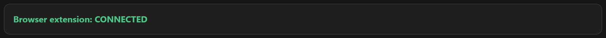
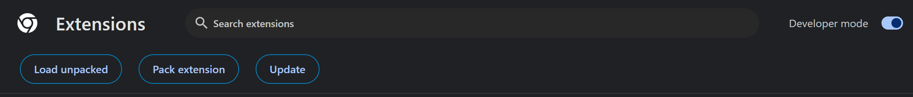
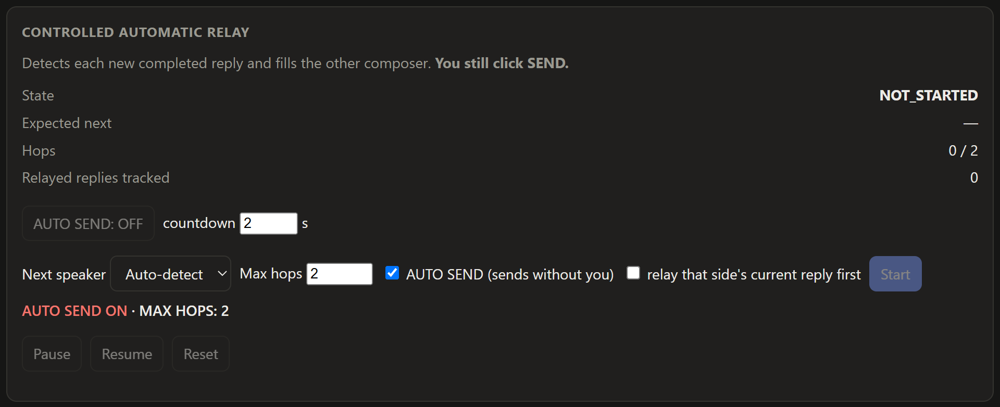

# CrossTalk

**CrossTalk links Claude and ChatGPT conversations and lets them pass replies between each other locally — no API keys required.**

> **v0.1.0 — Windows preview.** It works end to end on the setup described below, but it drives the apps' normal screens, so expect rough edges. Please read [Safety and account terms](#safety-and-account-terms) before using it.

## What it does

You pick one **Claude Desktop** conversation and one **ChatGPT** conversation (in your browser) and link them. When one side finishes a reply, CrossTalk copies that reply into the other side's message box and double-checks it arrived intact. **By default you press Send yourself.** An optional **AUTO SEND** mode can press Send for you, with a countdown, safety checks and a hop limit.

Everything runs on your PC. No API keys, no accounts, no passwords.

## Download

1. Go to the **[Releases](../../releases)** page of this repository.
2. Download the latest **`CrossTalk-…-win-x64.zip`**.

(You do **not** need to clone the repository or install anything else. Node.js is included.)

## Install

1. **Extract** the ZIP somewhere permanent (for example `C:\CrossTalk`). Keep the folder where it is.
2. Double-click **`Start CrossTalk.cmd`**.
3. A console window opens and your browser shows the CrossTalk dashboard at `http://127.0.0.1:17321/`. **Keep the console window open** — closing it stops CrossTalk.

Windows may show a warning for a downloaded ZIP or script; see [Known limitations](#known-limitations).

## Load the browser extension (once)

CrossTalk needs a small browser extension to read and fill your ChatGPT tab. The dashboard's top banner says **Browser extension: CONNECTED** or **NOT CONNECTED**.



If it says NOT CONNECTED:

**Chrome**
1. Open `chrome://extensions`
2. Turn on **Developer mode** (top right)
3. Click **Load unpacked**
4. Select the **`app\extension`** folder inside the CrossTalk folder you extracted

**Edge**
1. Open `edge://extensions`
2. Turn on **Developer mode** (left side)
3. Click **Load unpacked**
4. Select the **`app\extension`** folder



You only do this once, unless you move the CrossTalk folder (then remove the extension and load it again from the new place). Keep Chrome/Edge running; the connection can take up to 30 seconds to appear. *(Tested in Chrome. Edge uses the same extension but has not been tested yet.)*

## First setup

1. Open **Claude Desktop** and open the conversation you want to use (**Chat** or **Code**). Don't minimise the window.
2. Open **ChatGPT** (`chatgpt.com`) in Chrome/Edge on the conversation you want to use.
3. Open the CrossTalk dashboard (it opens by itself; otherwise visit `http://127.0.0.1:17321/`).
4. In the **ChatGPT (browser tab)** box, choose your ChatGPT tab from the drop-down.
5. Click **Link current Claude conversation ⇄ selected ChatGPT tab**.
6. In **Controlled automatic relay**, choose **Next speaker** (usually *Claude* if you are about to ask Claude something), leave **AUTO SEND** unticked, leave **Max hops** at 2, and click **Start**.

**Use throwaway conversations the first time.**

## Manual mode (start here)

With AUTO SEND off, CrossTalk does the tedious part and you stay in control:

1. You send a message to Claude yourself and wait for the answer.
2. CrossTalk notices the finished answer, pastes it into the ChatGPT message box and checks it.
3. The panel shows **SEND TO CHATGPT**. Look at the draft, then click it (or press Send in ChatGPT yourself).
4. When ChatGPT finishes, CrossTalk puts its answer into Claude's message box and shows **SEND TO CLAUDE**.

You can also skip the automatic part and use the two buttons **Claude → ChatGPT** and **ChatGPT → Claude**, which copy the latest finished reply once and never press Send.

## Auto Send (optional)



AUTO SEND is **off by default**. When on, after each reply is placed in the other message box CrossTalk waits a short **countdown** (2 seconds by default; there is a **Cancel** button), re-checks everything, and presses Send itself.

- A **hop** is one reply passed from one assistant to the other and sent. Claude → ChatGPT is hop 1; ChatGPT's answer back to Claude is hop 2.
- **Max hops** stops the loop. It defaults to **2**. Asking for more with AUTO SEND on needs a one-time confirmation, because the two assistants will keep talking to each other and use your usage allowance on both services until the limit.
- **Pause** always works, including during the countdown. Anything unexpected pauses or stops the relay and tells you why.
- **Use throwaway chats first.**

## Supported combinations

Only what has actually been tested is listed as supported.

| Setup | Status |
|---|---|
| Claude Desktop **Chat** ⇄ ChatGPT in **Chrome** | ✅ Verified (manual, controlled, and a 2-hop AUTO SEND cycle) |
| Claude Desktop **Code** ⇄ ChatGPT in **Chrome** | ✅ Verified (reading a reply that follows tool use is best-effort) |
| ChatGPT in **Edge** | ⚠️ Same extension, not tested yet |
| Claude in the browser (claude.ai) | ❌ Not supported yet |
| ChatGPT Desktop app | ❌ Not supported (never tested) |
| macOS / Linux, several pairs at once | ❌ Not supported |

## Troubleshooting

**"Browser extension: NOT CONNECTED"** — Make sure the extension is loaded from `app\extension` (see above), Developer mode is on, press **Reload** on the extension, and keep Chrome/Edge running. It can take up to 30 seconds. If you moved the folder, remove the extension and load it again from the new location.

**Claude shows "generating" when it isn't** — CrossTalk reads the Send/Stop button in Claude's message box. Make sure the right conversation is open and the window is **not minimised**, give it a few seconds, and try again. Still wrong? Open an issue (without private text).

**The Start button is greyed out** — You must **Link** first, and both sides must currently show the linked conversations (the Link box shows a green *current* tag for each).

**Wrong ChatGPT tab selected** — Pick the right tab in the drop-down and click **Link** again. If the Link box shows a red "different tab/conversation" tag, you are on a different conversation than the one you linked.

**"Composer already contains text"** — CrossTalk never overwrites something you typed. Clear that message box, then press **Resume**.

**The relay is paused** — Read the reason in the panel (identity changed, adapter not ready, blocked auto-send, …), fix it, then **Resume**, or **Reset** to start over.

**Hop limit reached** — That's the safety limit working. Press **Reset**, set a higher **Max hops**, and **Start** again.

## Safety and account terms

- **No API keys, no passwords stored, everything local.**
- CrossTalk automates the normal web and desktop screens of Claude and ChatGPT using your own logins. **Anthropic's and OpenAI's terms restrict automated access and programmatic extraction of output, so this may put your accounts at risk. Use it at your own risk.**
- Screens change without notice. When Claude Desktop or ChatGPT update their interface, CrossTalk may stop working or read the wrong text. It is designed to stop and tell you rather than guess.
- AUTO SEND spends usage on both services. Start with Max hops 2.

## Privacy

Based on what the code does:

- No telemetry and no hosted backend. CrossTalk's only network traffic is on your own PC (`127.0.0.1`): the dashboard, the browser extension, and the launcher's checks.
- Conversation text is handled in memory while relaying. It is **not** written to disk.
- It stores only your link (the Claude conversation title, and the ChatGPT conversation's title and URL path) and your settings in `%APPDATA%\crosstalk\`. Delete that folder to remove them.
- The extension can only act on `chatgpt.com` tabs, and only talks to CrossTalk on your PC.
- The raw "probe" tools in the repository (used by developers to study each app's screen) are not part of normal operation and their output is git-ignored.

## Known limitations

- **Windows 10/11 only**, 64-bit. One linked pair at a time.
- The extension is loaded **unpacked** (Developer mode); it is not in a browser store.
- **UI changes can break it** (see above).
- **SmartScreen / downloads:** the ZIP and scripts are **not code-signed**, so Windows may show "Windows protected your PC" or an "Open File - Security Warning". Choose *More info → Run anyway* only if you downloaded the ZIP from this repository's Releases page. (`node.exe` inside is the unmodified, signed official Node.js build.)
- **Known caveat:** in one early 10-hop AUTO SEND test, two sends were blocked because the safety re-read of the source reply came out different from the first read. It fails safe (nothing is sent). Whitespace-independent matching and a settle-and-retry with detailed diagnostics have since been added, but the original cause was not reproduced. See [docs/FINDINGS.md](docs/FINDINGS.md).
- Replies are copied as plain text (formatting such as bold or code fences may be lost; the words are preserved).

## Coming soon (planned — not available yet)

**None of the items below work today.** They are plans and ideas, not promises, and there are no dates. The only supported setup is the one in [Supported combinations](#supported-combinations).

**Coming soon**
- **Claude Web** — use claude.ai in your browser instead of Claude Desktop.
- **ChatGPT Desktop / Codex** — use the ChatGPT desktop app or Codex instead of a browser tab.
- **Gemini** — link Google's Gemini as one side of a pair.
- **More AI providers** — other AI assistants later on.
- **Multiple paired conversations** — run more than one link at the same time.
- **Multiple links / workflows** — set up and name several different pairings.
- **Background relay / tray mode** — keep CrossTalk running quietly in the system tray instead of a console window, and relay more reliably while you do other things (better unattended / background operation).
- **Built-in browser / web-session support** — an optional built-in browser window so you would not need to install the browser extension. This needs research first: some sites (for example Google sign-in) refuse to let you log in inside an embedded browser.

**Longer-term ideas**
- **Broader browser support** — more browsers beyond Chrome and Edge, where practical.
- **Easier extension installation** — fewer manual steps than "Load unpacked".
- **Improved multi-link dashboard** — see and manage several links in one place.
- **Installer and auto-update** — a normal installer, and updates without downloading a new ZIP.
- **Presets / workflows** — ready-made setups for different combinations of AI tools.

## Want to help?

Contributions are welcome — bug reports, ideas, fixes and new provider support.

- **Found a bug or have an idea?** Open a [GitHub Issue](../../issues) (use the templates).
- **Bigger change** (a new provider, a new feature, anything that touches the safety checks)? Please **open an Issue first** so we can agree on the approach before you spend time on it.
- **Small fix** (typo, wording, a clear bug fix)? Go straight to a **Pull Request**.
- **How:** fork the repository, make your change on a branch, and open a Pull Request. [CONTRIBUTING.md](CONTRIBUTING.md) explains how to build and test.
- **Privacy:** never post private conversation logs, credentials, tokens, browser data or personal information in public Issues or Pull Requests. Replace anything private with `[redacted]`.

## For developers

Requires Node.js 22+.

```
git clone <this repository>
cd <folder>
npm install
npm run build      # builds dist/
npm start          # hub + dashboard on http://127.0.0.1:17321/
npm test           # unit tests
npm run package    # portable ZIP into release/ (downloads and verifies the official Node build)
```

- Or double-click the repository's own `Start CrossTalk.cmd` (asks before running `npm install`).
- Load `dist\extension` as the unpacked extension when running from source.
- Design: [ARCHITECTURE.md](ARCHITECTURE.md). What was learned about each app's screen: [docs/FINDINGS.md](docs/FINDINGS.md). Contributing: [CONTRIBUTING.md](CONTRIBUTING.md). Security: [SECURITY.md](SECURITY.md). Changes: [CHANGELOG.md](CHANGELOG.md).

## License

MIT — see [LICENSE](LICENSE). The portable package also contains Node.js (MIT) and `ws` (MIT); see `THIRD-PARTY-NOTICES.txt` inside it.
